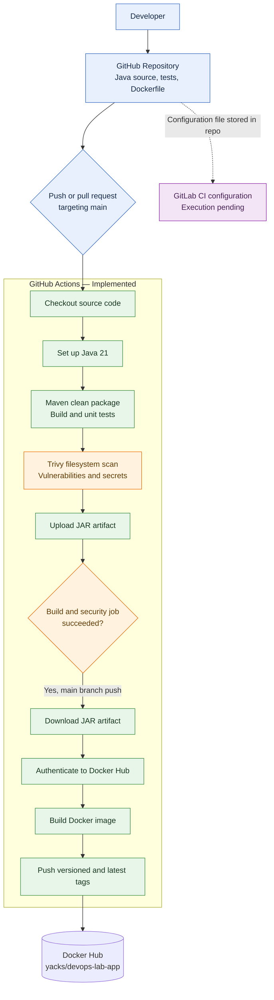

# Lab 3 — CI/CD Pipeline Architecture

## 1. Overview

This document describes the architecture of the Lab 3 CI/CD security pipeline.

The current implementation uses GitHub Actions to automate the Java application build, unit testing, security scanning, and Docker image publishing.

A GitLab CI configuration has also been created to demonstrate an equivalent pipeline. Its execution and validation remain pending.

## 2. Architecture Diagram

## 3. Pipeline Execution Flow

1. **Source code:** A developer pushes changes or opens a pull request targeting `main`.
2. **Build environment:** GitHub Actions checks out the repository and sets up Java 21.
3. **Build and testing:** Maven compiles the application, executes unit tests, and packages the application as a JAR.
4. **Security scanning:** Trivy scans the repository for vulnerabilities and secrets using the configured severity and exit-code settings.
5. **Artifact handling:** The pipeline uploads the JAR so the publishing job can download it.
6. **Publishing conditions:** The Docker publishing job waits for the build and security job to succeed and only runs for a push to `main`.
7. **Container creation:** Docker builds an image using the Dockerfile and the downloaded JAR.
8. **Registry publishing:** The pipeline authenticates with Docker Hub and publishes the versioned and `latest` image tags.

## 4. Failure Handling

The pipeline uses job dependencies to prevent Docker publishing when the required build and security job fails.

For example, if Maven tests fail, the workflow does not proceed to publish the image. If Trivy finds a matching HIGH or CRITICAL issue under the configured scan policy, the security step is configured to fail.

The exact scan results depend on the code, dependencies, scanner data, and configuration.

## 5. GitLab CI/CD

The `.gitlab-ci.yml` file represents a second implementation of the pipeline.

Its intended stages are:

- Build and test the Java application.
- Scan the repository using Trivy.
- Build and publish the Docker image.

The GitLab configuration has been created and pushed to GitHub, but it has not yet been executed in GitLab. Runner configuration, credentials, and end-to-end behaviour must be validated before the GitLab implementation can be considered complete.

## 6. Key Architecture Components

| Component | Responsibility |
|---|---|
| GitHub | Hosts the source code and triggers workflows |
| GitHub Actions | Orchestrates automated pipeline jobs |
| Java 21 and Maven | Build, test, and package the application |
| Trivy | Scan the repository for configured security issues |
| Workflow artifacts | Transfer the packaged JAR between jobs |
| Docker | Package the application into a container image |
| Docker Hub | Store and distribute the published image |
| GitLab CI/CD | Alternative pipeline implementation, pending validation |

## 7. Summary

The architecture separates application building, security scanning, artifact transfer, and container publishing into distinct stages of the delivery process.

This separation makes the pipeline easier to understand, troubleshoot, and maintain. It also establishes a foundation for future improvements such as dependency scanning, SBOM generation, image-digest verification, and automated deployment.

**Current status:** GitHub Actions pipeline reported successful; GitLab CI/CD execution pending.
